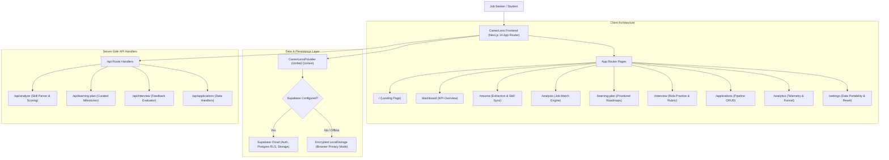

# CareerLens

> **Your career, with a clearer direction.**  
> A career planning and job-readiness workspace for students, graduates, and early-career job seekers.  
> *Production Next.js 14 App Router &bull; TypeScript &bull; Tailwind CSS &bull; Supabase PostgreSQL & Auth with LocalStorage Privacy Fallback &bull; 100% Deterministic Matching Engine*

[](https://nextjs.org/)
[](https://www.typescriptlang.org/)
[](https://tailwindcss.com/)
[](https://supabase.com/)
[](https://opensource.org/licenses/MIT)

---

## Overview

**CareerLens** is an independent, full-stack career development SaaS platform designed to guide job seekers from self-assessment to offer acceptance with transparency, structure, and actionable feedback.

Unlike generic dashboards or opaque AI black boxes, CareerLens implements **deterministic competency matching**, **rule-based gap prioritization**, and a **dual-engine data architecture** (Supabase Cloud + LocalStorage Offline Fallback).

---

## Architecture & System Design



---

## Core Features & Modules

### 1. Job Description Compatibility Analyzer (`/analysis`)
- **Deterministic Token-Boundary Matching:** Scans arbitrary job postings against 150+ technology aliases and canonical skills without substring collisions (e.g. `c` will not falsely match `css`; `java` will not match `javascript`).
- **Segmented Requirements:** Categorizes requirements into *Required / Minimum Qualifications* (70% weight) and *Preferred / Bonus Competencies* (30% weight).
- **Zero-Denominator Guard:** If a user pastes text lacking recognizable technical skills, CareerLens informs the user to paste a full qualifications section rather than displaying a false 0% rating or phantom gaps.
- **One-Click Actions:** Instantly add identified gaps to your personalized learning plan or create a tracked application in the pipeline.

### 2. Personalized Learning Roadmaps (`/learning-plan`)
- **Automatic Gap Mapping:** Automatically translates missing skills from job analysis into milestone goals.
- **Three-Tier Priority System:** Categorizes skills into **High Priority** (core qualification gaps), **Medium Priority** (supporting frameworks), and **Supplementary** (best practices and tools).
- **Practical Deliverables:** Each milestone includes core concepts, a hands-on mini-project specification, and links to official documentation.
- **Custom Goal Creator:** Add personal technical goals with custom timeframes and project deliverables.

### 3. Role-Specific Interview Preparation (`/interview`)
- **Role Tracks:** Frontend Engineering, Backend Engineering, Full Stack, Data Analytics, and Cloud & DevOps.
- **Categories:** Core Technical Concepts, Coding & Systems Architecture, and Behavioral & HR (STAR method).
- **Interactive Workbench:** Draft your answer in real time and receive instant, constructive rubric evaluation measuring concept coverage, conciseness, and missing points.
- **Progress Tracking:** Toggle drill completion to monitor overall preparation readiness.

### 4. Job Application Tracker (`/applications`)
- **Pipeline Stages:** Wishlist $\rightarrow$ Applied $\rightarrow$ Screening $\rightarrow$ Interviewing $\rightarrow$ Offer $\rightarrow$ Rejected.
- **Full CRUD Management:** Create, view, edit, search, and delete application records with modal forms and inline status dropdowns.
- **Deadlines & Notes:** Track application dates, follow-up reminders, salary targets, and interview notes.

### 5. Résumé Skill Extraction & Profile Sync (`/resume`)
- **Text Extraction:** Paste or upload plain text/markdown resumes for automated skill audits.
- **Bidirectional Sync:** Automatically links newly detected skills to your verified profile tags.

### 6. Career Telemetry & Analytics (`/analytics`)
- **Conversion Funnel:** Calculates conversion rates across pipeline stages (Applied $\rightarrow$ Screened $\rightarrow$ Interviewing $\rightarrow$ Offer).
- **Readiness Ratios:** Visualizes verified profile skills vs. required job qualifications.

### 7. Settings, Portability & Privacy (`/settings`)
- **JSON Data Export:** Download a complete, unencrypted JSON archive of your entire workspace at any time.
- **Workspace Reset:** Cleanly wipe local browser cache with safety confirmation.
- **Dual-Mode Indicator:** Transparently reports whether connected to Supabase Cloud or operating in offline LocalStorage mode.

---

## Getting Started

### Prerequisites
- [Node.js](https://nodejs.org/) v18.0.0 or higher
- [npm](https://www.npmjs.com/) v9.0.0 or higher

### Local Development Setup

1. **Clone the repository:**
   ```bash
   git clone https://github.com/rajy24/CareerLensAi.git
   cd CareerLensAi
   ```

2. **Install dependencies:**
   ```bash
   npm install
   ```

3. **Configure Environment Variables (Optional for Cloud Mode):**
   Copy `.env.example` to `.env.local`:
   ```bash
   cp .env.example .env.local
   ```
   > **Note:** If you do not provide Supabase credentials, CareerLens runs automatically in offline **LocalStorage Mode** with 100% feature availability and zero external dependencies.

4. **Run the development server:**
   ```bash
   npm run dev
   ```
   Open [http://localhost:3000](http://localhost:3000) in your browser.

5. **Production Build & Verification:**
   ```bash
   npm run build
   npm run start
   ```

---

## Supabase Database Schema (Production Cloud Setup)

If connecting to Supabase Cloud, run the provided SQL migration in your Supabase SQL Editor:
- Schema file location: [`supabase/schema.sql`](./supabase/schema.sql)
- Contains PostgreSQL tables for `profiles`, `resumes`, `job_analyses`, `learning_plans`, `interview_sessions`, and `job_applications`.
- Includes Row-Level Security (RLS) policies ensuring users can only read and write their own data.

---

## Deployment to Vercel

CareerLens is architected for zero-configuration static and serverless deployment on [Vercel](https://vercel.com):

1. Push your repository to GitHub (`https://github.com/rajy24/CareerLensAi`).
2. Import the project into your Vercel Dashboard.
3. (Optional) Add your Supabase environment variables in Vercel Project Settings:
   - `NEXT_PUBLIC_SUPABASE_URL`
   - `NEXT_PUBLIC_SUPABASE_ANON_KEY`
4. Click **Deploy**.

---

## License

This project is licensed under the MIT License — see the [LICENSE](LICENSE) file for details.
